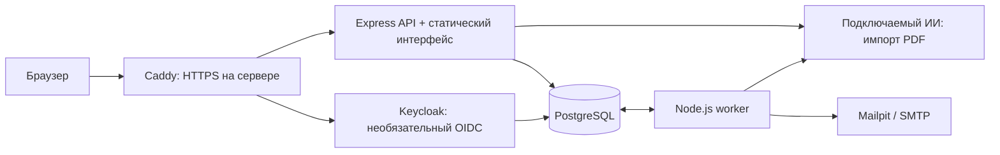

# Архитектура

Серверное приложение на Node.js 20 / Express 5, PostgreSQL 17 и HTML/CSS/JavaScript без клиентского фреймворка. Интерфейс продолжает готовый дизайн `prototype-v13`. Его шаблон и CSS объединяются с действующими клиентскими модулями при сборке. Сгенерированный `public/` находится только в образе/локальном окружении.

При локальном запуске браузер обращается прямо к API на 8088; Caddy и Keycloak не требуются. Одна PostgreSQL содержит данные приложения; при подключении Keycloak генератор создаёт ему отдельную БД и роль. PostgreSQL наружу не публикуется.

## Компоненты

| Компонент | Ответственность |
| --- | --- |
| `src/server.mjs`, `routes.mjs`, `extensions.mjs` | HTTP, роль/сессия, схемы, CSRF, транзакции, идемпотентность и контракт |
| `profiles.mjs`, `potential.mjs`, `cognitive.mjs` | Резюме, самооценка, когнитивный маршрут и объяснение результата |
| `assessment.mjs`, `scoring.mjs` | Технические попытки, адаптация, рубрики, баллы и финализация |
| `matching.mjs`, `invitations.mjs`, `opportunities.mjs` | Потребности, подбор, контактные разрешения, вакансии и отклики |
| `experience.mjs`, `experience-contract.mjs` | Версии заявлений опыта, проверка, решения и история |
| `auth.mjs`, `oidc.mjs` | OTP, cookie-сессии, OIDC/PKCE и роли |
| `ai.mjs`, `resume-extraction.mjs`, `pdf-import.mjs`, `pdf.mjs` | Вызовы модели, проверка извлечённых полей, импорт/экспорт PDF |
| `worker.mjs` | Очередь оценки, адаптация, финализация, письма и обслуживание сроков |
| `seed.mjs`, `hackathon-demo.mjs`, `potential-demo.mjs` | Синтетические данные и готовые демонстрационные сценарии |

## Хранение и согласованность

Миграции в `migrations/` создают пользователей и сессии, резюме и публикацию, компании и потребности, версии банков, попытки и задачи, подтверждения, приглашения, доступы к контактам, вакансии/отклики, заявления опыта, аудит, rate buckets, идемпотентные ответы, jobs и outbox.

API использует SQL-параметры и транзакции. Изменяемые сущности имеют `revision`; устаревшее сохранение получает 409. `Idempotency-Key` сохраняет результат операции в серверном scope. Повтор с другим телом отклоняется. Владелец и компания берутся из сессии, а не из присланного `owner_id`.

Задачи и письма создаются в PostgreSQL вместе с бизнес-действием. Worker забирает их через `FOR UPDATE SKIP LOCKED`, lease и токен владения. Неудачные задачи повторяются ограниченно; непроверенный ответ остаётся непроверенным. Отправка писем через SMTP может повториться при сбое между отправкой и фиксацией результата; стабильный Message-ID помогает диагностировать такой случай, гарантии exactly-once для внешнего SMTP нет.

Версии банков сохраняются в БД, а показанные вопросы и рубрики замораживаются в попытке. Архивы в `private/archive/` нужны мигратору для воспроизведения прежних редакций. ИИ не может изменить уже показанный вопрос.

## Авторизация и приватные проекции

OTP создаёт HttpOnly cookie-сессию. Изменяющие запросы проверяют Origin и CSRF, роли и принадлежность объекта. Secure cookie используется при HTTPS. Код демо и готовые профили — намеренно открытые демонстрационные маршруты, не способ аутентификации реальных людей.

Keycloak — отдельный работающий сервис. OIDC использует Authorization Code Flow, PKCE S256, state/nonce и проверку подписи JWT, issuer, audience и ролей. Приложение создаёт собственную сессию после callback. Токены/секрет клиента остаются на сервере. Генератор realm содержит только вымышленных пользователей; оператор получает отдельный приватный пароль.

Публичный профиль и PDF создаются из разрешённой серверной проекции. Ответы, ключи банка, приватные поля и контакты не открываются работодателю произвольным идентификатором. Контакты требуют действующего разрешения талант–компания. Отзыв применяет новые ограничения к последующим запросам.

## ИИ и PDF

Модуль `ai.mjs` обращается к OpenAI-совместимому `chat/completions` по настроенным URL и модели. Запросы ограничены таймаутом и размером ответа. Техническая оценка проверяет структуру четырёх критериев и дословное основание положительного балла. Адаптация проверяет версию банка, hash контекста и допустимые item_id; при недоступности есть детерминированный резервный выбор.

Для импорта PDF Poppler извлекает текстовый слой; ИИ получает ограниченный фрагмент только после выбора этого режима пользователем. Извлечённые поля сопровождаются основаниями и показываются как предложение. Импорт не публикует и не сохраняет резюме автоматически. Неизвестная структура или скан могут потребовать ручного заполнения. Секрет API берётся из environment, в клиент не передаётся.

Контейнер приложения работает от пользователя `node`, без дополнительных capabilities. Docker-образы закреплены digest, зависимости — lockfile. Это проверяемая архитектура демо; отдельные production-процессы, нагрузочная аттестация и независимая оценка безопасности в этот выпуск не включены.
